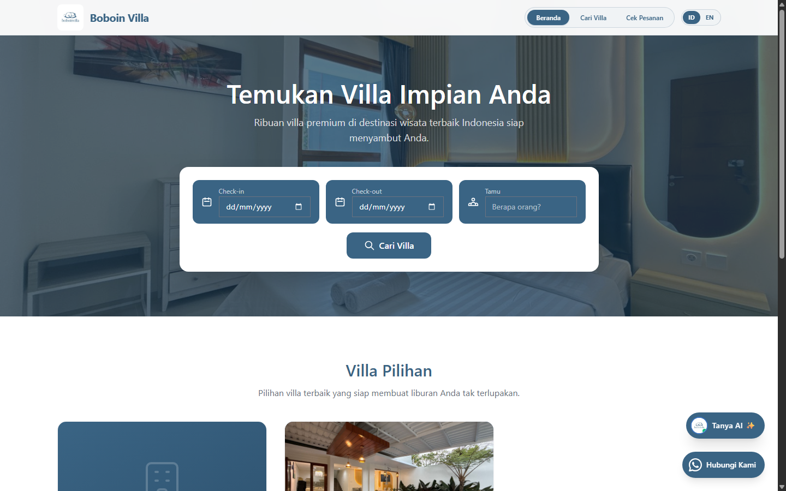
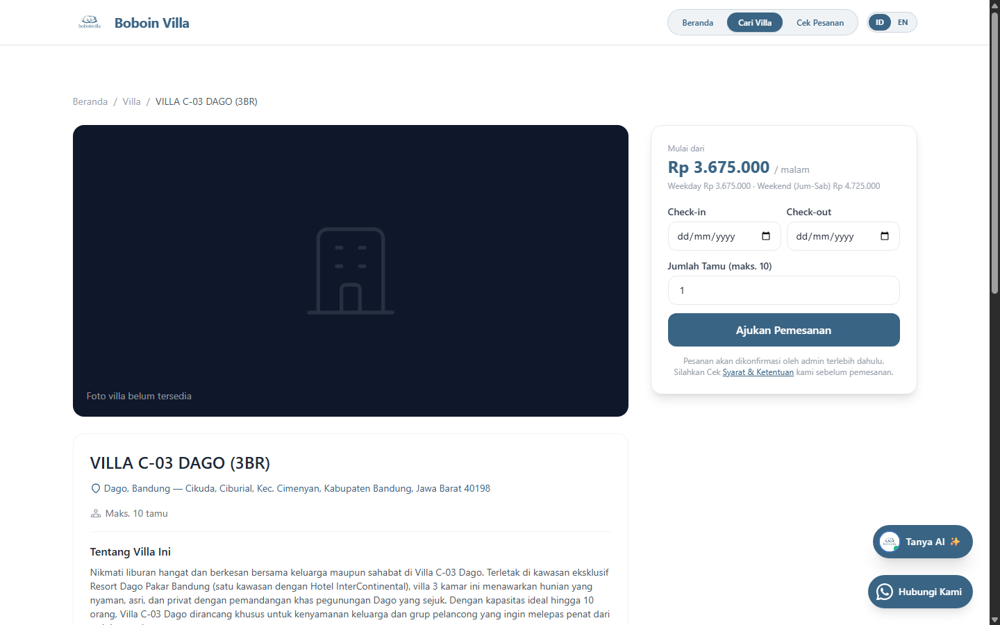
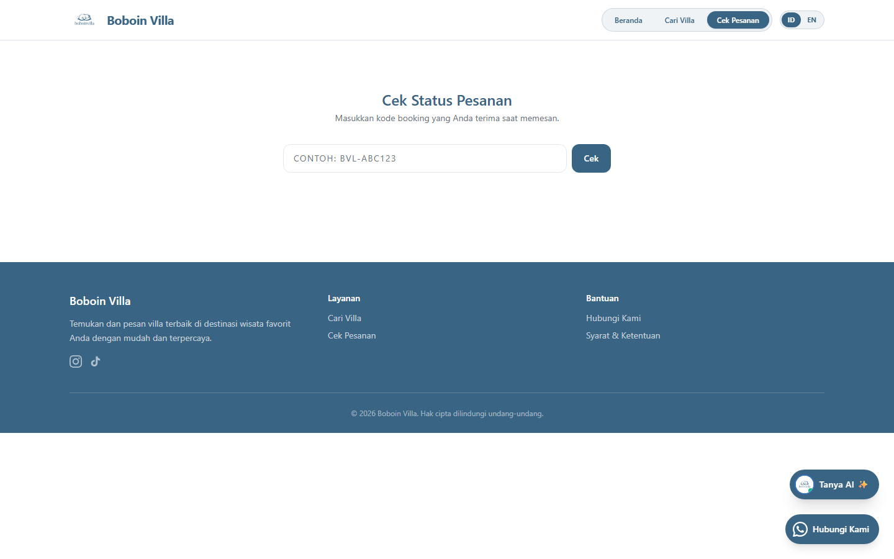
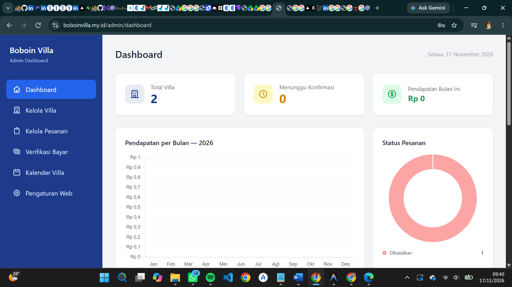
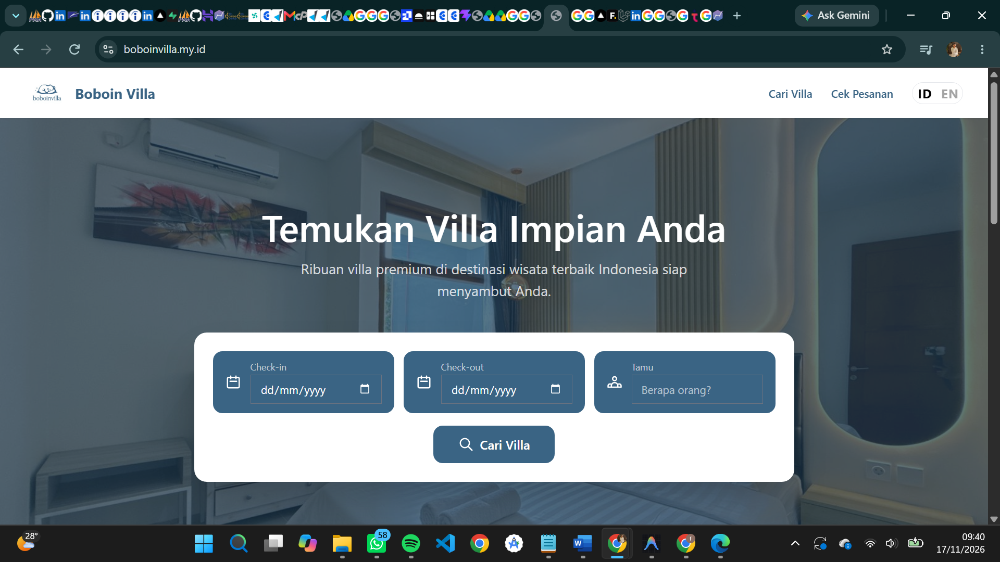
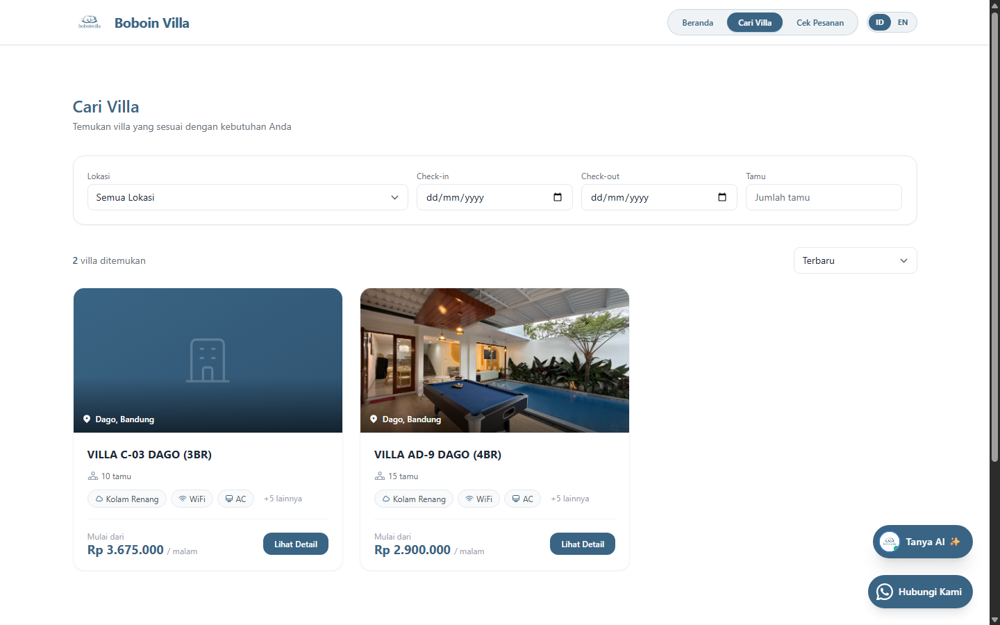
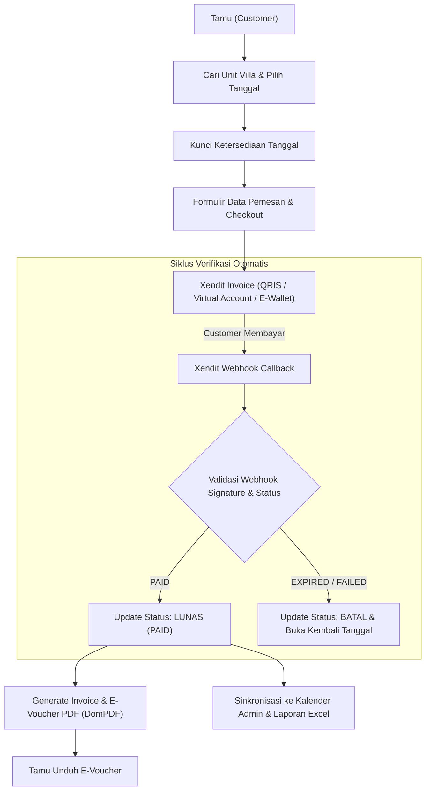

<div align="center">

# 🏡 Boboin Villa

**Platform reservasi dan manajemen sewa villa modern berbasis web: pencarian unit, kalender ketersediaan real-time, invoice digital PDF, dan transaksi otomatis terintegrasi Payment Gateway Xendit.**

[](composer.json)
[](composer.json)
[](composer.json)
[](composer.json)
[](package.json)
[](package.json)
[](https://xendit.co)
[](.env.example)

[Tentang](#tentang) · [Fitur Utama](#fitur-utama) · [Tangkapan Layar](#tangkapan-layar) · [Alur Kerja](#alur-kerja) · [Teknologi](#teknologi) · [Mulai Cepat](#mulai-cepat) · [Integrasi Pembayaran](#integrasi-pembayaran-xendit) · [Akun Demo](#akun-demo) · [Struktur Repository](#struktur-repository)

🌐 **Live Website**: [boboinvilla.my.id](https://boboinvilla.my.id/)

</div>

---

## Tentang

**Boboin Villa** menyederhanakan seluruh alur operasional bisnis penyewaan villa dalam satu platform terpadu. Pengunjung dapat mengeksplorasi katalog villa dengan galeri foto beresolusi tinggi, memeriksa ketersediaan tanggal secara *live*, dan menyelesaikan pembayaran instan melalui berbagai kanal (QRIS, Virtual Account bank nasional, dan E-Wallet). 

Di balik layar, sistem secara otomatis mengunci tanggal untuk mencegah *double-booking*, menerbitkan e-tiket/voucher reservasi resmi berformat PDF, mencatat pemindahan status transaksi via webhook callback, serta menyajikan dasbor manajemen okupansi dan laporan pendapatan bagi pemilik atau pengelola villa.

---

## Fitur Utama

| Modul | Kemampuan & Fungsi Utama |
| :--- | :--- |
| **Katalog & Pencarian Villa** | Penjelajahan unit villa interaktif, filter rentang harga, kapasitas tamu, lokasi, serta fasilitas spesifik (kolam renang, Wi-Fi, BBQ, dll). |
| **Reservasi & Booking Engine** | Pemilihan tanggal *check-in* & *check-out* dengan kalender ketersediaan real-time; kalkulasi otomatis total malam, pajak, dan biaya layanan. |
| **Integrasi Payment Gateway (Xendit)** | Pembayaran otomatis multi-kanal (QRIS, BCA/BRI/Mandiri/BNI Virtual Account, OVO/Dana/ShopeePay) dengan verifikasi pembayaran via webhook callback tanpa perlu upload bukti transfer manual. |
| **E-Tiket & Invoice Digital (DomPDF)** | Penerbitan invoice resmi dan voucher reservasi instan berformat PDF dengan nomor referensi unik dan rincian transaksi lengkap. |
| **Dasbor Admin & Operasional** | Manajemen data master villa, upload galeri foto, blokir tanggal reservasi untuk pemeliharaan (*maintenance*), dan pemantauan kalender okupansi. |
| **Laporan & Pembukuan (Excel)** | Rekapitulasi data reservasi, omzet bulanan, dan status pelunasan yang dapat diekspor langsung ke berkas spreadsheet `.xlsx`. |
| **Role-Based Access Control (RBAC)** | Pembagian peran dan hak akses aman menggunakan Spatie Permission untuk Administrator, Staff Operasional, dan Tamu (*Customer*). |

---

## Tangkapan Layar

<div align="center">

<table>
  <tr>
    <td width="50%"><br><sub><b>Beranda & Katalog</b> — Penelusuran katalog villa dengan filter tanggal dan kapasitas</sub></td>
    <td width="50%"><br><sub><b>Detail Unit</b> — Galeri fasilitas, spesifikasi kamar, dan kalender ketersediaan</sub></td>
  </tr>
  <tr>
    <td><br><sub><b>Checkout & Xendit Gateway</b> — Pilihan kanal pembayaran QRIS dan Virtual Account</sub></td>
    <td><br><sub><b>Invoice & E-Voucher</b> — Berkas digital bukti reservasi resmi berformat PDF</sub></td>
  </tr>
  <tr>
    <td><br><sub><b>Dasbor Admin</b> — Ringkasan okupansi, reservasi aktif, dan tren pendapatan</sub></td>
    <td><br><sub><b>Manajemen Unit</b> — Pengaturan tarif per malam, galeri foto, dan tanggal maintenance</sub></td>
  </tr>
</table>

<sub><i>Catatan: Seluruh data nama tamu dan transaksi pada tangkapan layar di atas menggunakan data uji coba (sandbox/seeder).</i></sub>

</div>

---

## Alur Kerja



---

## Teknologi

| Lapisan Sistem | Teknologi / Pustaka | Keterangan |
| :--- | :--- | :--- |
| **Core Framework** | PHP 8.2+, Laravel 12.0 | Framework backend modern dengan performa tinggi & keamanan bawaan |
| **Interactive UI** | Livewire 3.6, Livewire Volt 1.7 | Komponen antarmuka reaktif dan dinamis tanpa overhead SPA terpisah |
| **Styling & Assets** | Tailwind CSS 3.x, Vite 7.0 | Utilitas CSS modern dan bundler aset berkecepatan tinggi |
| **Payment Gateway** | Xendit PHP SDK 7.0 | Gateway pembayaran resmi Indonesia (QRIS, VA, E-Wallet) |
| **Database** | MySQL 8.0+ / MariaDB | Relasional database dengan transaksi ACID dan indeks tanggal pemesanan |
| **Hak Akses (RBAC)** | Spatie Laravel Permission 6.25 | Pengelolaan multi-peran (Admin, Staff, Customer) |
| **Dokumen & Laporan** | Barryvdh DomPDF 3.1, Maatwebsite Excel 3.1 | Pembuatan invoice PDF otomatis dan ekspor laporan Excel `.xlsx` |

---

## Mulai Cepat

### Prasyarat Sistem
Pastikan perangkat Anda telah terpasang:
* **PHP** versi 8.2 atau lebih baru dengan ekstensi `pdo_mysql`, `mbstring`, `openssl`, `curl`, `gd`.
* **Composer** (Dependency manager PHP).
* **Node.js** (v18+) & **npm**.
* **MySQL** Server (lokal via XAMPP/Laragon/Docker).

### Panduan Instalasi (PowerShell / Terminal)

1. **Clone repository ini:**
   ```powershell
   git clone https://github.com/farrelalghani/BoboinVIilla.git
   Set-Location BoboinVIilla
   ```

2. **Pasang dependensi PHP dan Node.js:**
   ```powershell
   composer install
   npm install
   ```

3. **Salin konfigurasi environment:**
   ```powershell
   Copy-Item .env.example .env
   php artisan key:generate
   ```

4. **Konfigurasi Database di file `.env`:**
   Sesuaikan baris koneksi database berikut pada file `.env`:
   ```env
   DB_CONNECTION=mysql
   DB_HOST=127.0.0.1
   DB_PORT=3306
   DB_DATABASE=boboin_villa
   DB_USERNAME=root
   DB_PASSWORD=
   ```

5. **Jalankan migrasi tabel dan data seeder:**
   ```powershell
   php artisan migrate --seed
   ```

6. **Buat tautan simbolis penyimpanan publik:**
   ```powershell
   php artisan storage:link
   ```

7. **Jalankan server pengembangan:**
   ```powershell
   # Jalankan server Laravel dan compiler Vite secara bersamaan:
   composer run dev
   ```
   *Atau jalankan pada dua terminal terpisah:*
   ```powershell
   php artisan serve   # Terminal 1 (Akses http://127.0.0.1:8000)
   npm run dev         # Terminal 2 (Hot module replacement)
   ```

---

## Integrasi Pembayaran (Xendit)

Aplikasi ini menggunakan API Xendit v7 untuk pembuatan *checkout invoice*. Untuk mengaktifkan simulasi pembayaran di lingkungan lokal (*sandbox*):

1. Daftar akun pengembang gratis di [Xendit Dashboard](https://dashboard.xendit.co/).
2. Masuk ke mode **Test Mode (Sandbox)**.
3. Ambil **Secret API Key** dan **Webhook Verification Token** di menu *Settings $\rightarrow$ Developers*.
4. Masukkan ke dalam file `.env`:
   ```env
   XENDIT_SECRET_KEY=xnd_development_...
   XENDIT_PUBLIC_KEY=xnd_public_development_...
   XENDIT_WEBHOOK_VERIFICATION_TOKEN=...
   ```
5. Endpoint webhook callback aplikasi mengarah ke:
   ```text
   POST https://domain-anda.com/api/xendit/callback
   ```
   *(Untuk pengujian lokal, gunakan tunnel seperti ngrok untuk meneruskan callback Xendit ke localhost:8000).*

---

## Akun Demo

Seeder bawaan menyediakan akun uji coba untuk pengujian lokal:

| Peran (Role) | Email Login | Kata Sandi | Hak Akses |
| :--- | :--- | :--- | :--- |
| **Super Admin** | `admin@boboinvilla.com` | `password` | Akses penuh ke seluruh modul, kelola unit, laporan omzet, dan pengguna |
| **Staff Operasional** | `staff@boboinvilla.com` | `password` | Kelola reservasi, verifikasi tamu *check-in* & *check-out*, update ketersediaan |
| **Tamu (Customer)** | `guest@example.com` | `password` | Riwayat reservasi mandiri, unduh invoice & voucher digital |

> ⚠️ *Catatan Keamanan: Harap ganti kredensial bawaan sebelum menggunakan aplikasi di server produksi.*

---

## Struktur Repository

```text
app/
├── Http/Controllers/        # Controller API & Webhook Callback Xendit
├── Livewire/                # Komponen interaktif Livewire 3 (Booking, Filter, Katalog)
│   └── Volt/                # Single-file Volt components
├── Models/                  # Model Eloquent (Villa, Booking, Payment, Customer)
├── Services/                # Service layer (XenditService, PdfInvoiceService)
database/
├── migrations/              # Skema tabel database MySQL
├── seeders/                 # Data awal master villa, paket, peran, & pengguna demo
docs/
└── screenshots/             # Tangkapan layar antarmuka untuk dokumentasi
resources/
├── views/                   # Template Blade & layout aplikasi
│   ├── livewire/            # Tampilan reaktif Livewire
│   └── pdf/                 # Layout template invoice & voucher DomPDF
routes/
├── web.php                  # Rute publik, katalog, dan panel admin
└── api.php                  # Rute webhook callback pembayaran
```

---

## Lisensi & Atribusi

Proyek ini dikembangkan oleh **[Farrel Muhammad Alghani](https://github.com/farrelalghani)** sebagai portofolio sistem reservasi & manajemen properti kelas produksi.

---

<div align="center">
<sub>Dibangun dengan dedikasi menggunakan <b>Laravel 12</b>, <b>Livewire 3</b>, dan <b>Xendit Payment Gateway</b>.</sub>
</div>
